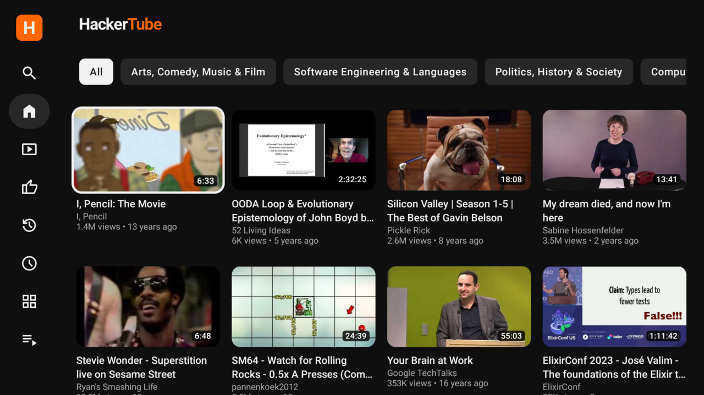
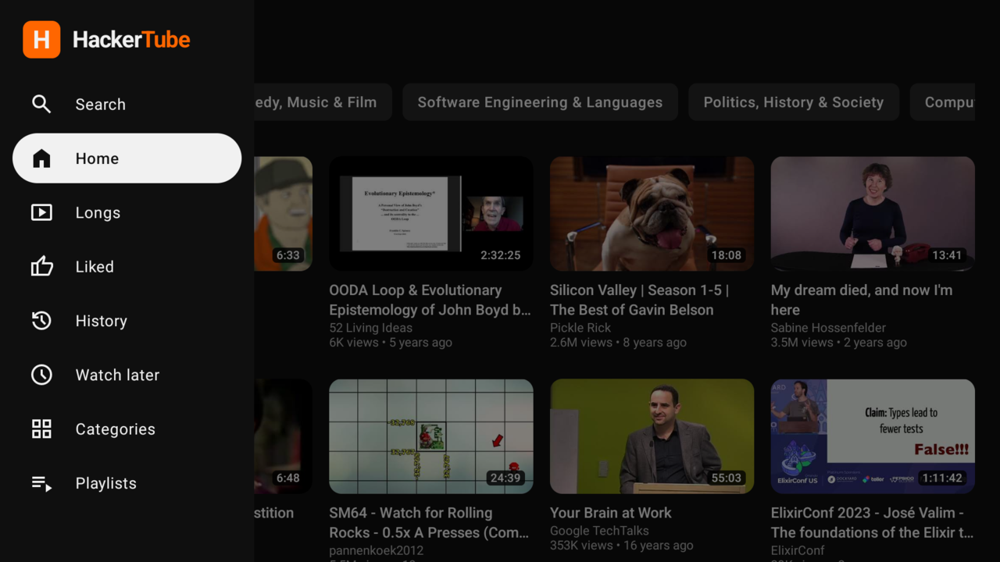

# HackerTube for TV

An Android TV app for [HackerTube](https://hackertube.org), the videos that Hacker News recommends. When you select a video, the YouTube app on your TV plays it.



## Features

The app has the same pages and the same look as hackertube.org:

- Home, with a chip for each topic area
- Search, by words or by meaning
- Longs, Liked, History and Watch later
- Categories and Playlists

To play a video in YouTube, push OK on the video. When the video stops, or when you push Back, the TV shows HackerTube again.

To open the page of a video, hold OK on the video. The page shows the summary, the reason that HN recommends the video, the HN comments, and the next videos. On this page, you can like the video, mark it "Not for me", or save it to Watch later.




## Install on a TV

You must have an Android TV or Google TV with Android 8 or later, and the YouTube app.

1. On the TV, activate the developer options and network debugging.
2. Download `hackertube-tv.apk` from the [latest release](https://github.com/ephraimduncan/hackertube.tv/releases/latest).
3. Connect to the TV: `adb connect <tv-ip>:5555`.
4. On the TV, accept the debugging prompt.
5. Install the app: `adb install hackertube-tv.apk`.

HackerTube then shows in the row of apps on the TV home screen.

## Build

You must have JDK 21 and the Android SDK (platform 37).

```sh
./gradlew assembleRelease
adb install app/build/outputs/apk/release/app-release.apk
```

The release build uses the debug key. Thus, you can install it on your TV without more setup.

## How it works

The app reads the JSON API of hackertube.org. The website uses the same API: `/api/feed`, `/api/list`, `/api/search`, `/api/video`, `/api/related`, `/api/browse`, `/api/playlists` and `/api/playlist`.

The website keeps your likes, history and Watch later list in the browser. The app keeps them on the TV. As on the website, the Home feed sends them to the API, and the API uses them to select your videos.

To play a video, the app sends a YouTube link to the YouTube app for TV. We wrote the app in Kotlin with [Compose for TV](https://developer.android.com/training/tv/playback/compose).

## Credits

- The videos, summaries and curation come from [hackertube.org](https://hackertube.org). This project is not part of HackerTube.
- The icons are [Material Symbols](https://github.com/google/material-design-icons) by Google, under the Apache License 2.0.

## License

[MIT](LICENSE)
